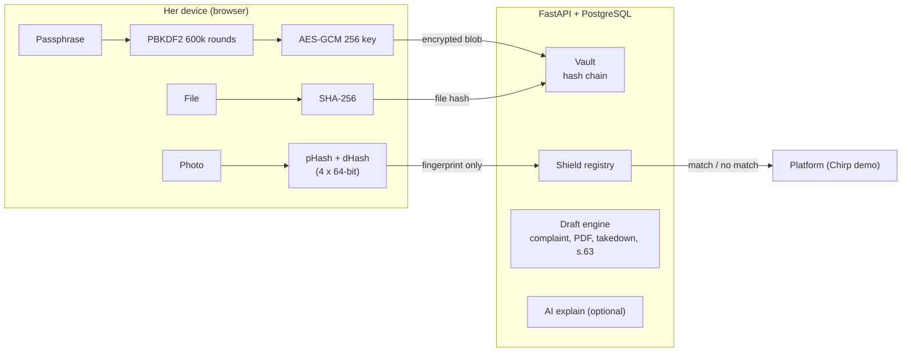
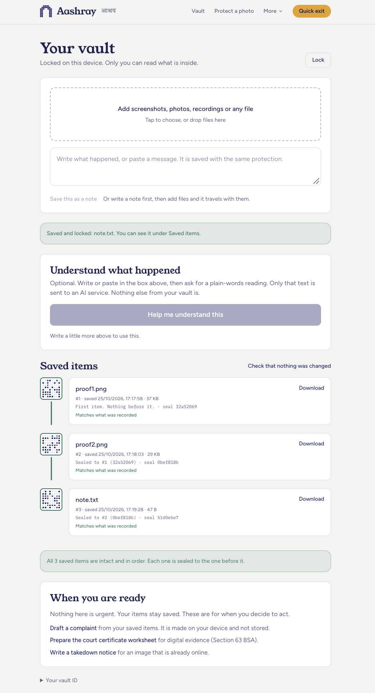
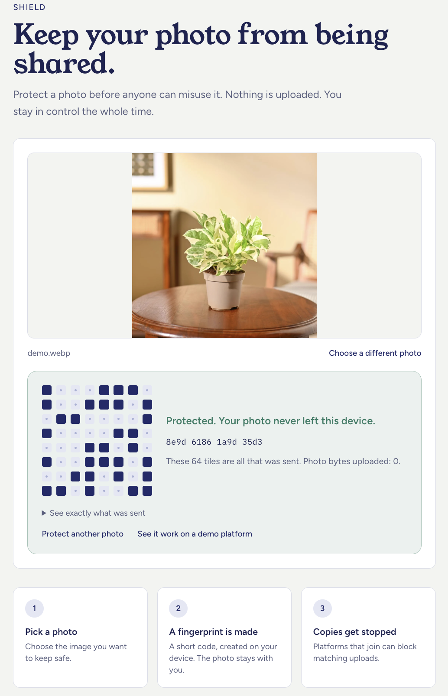
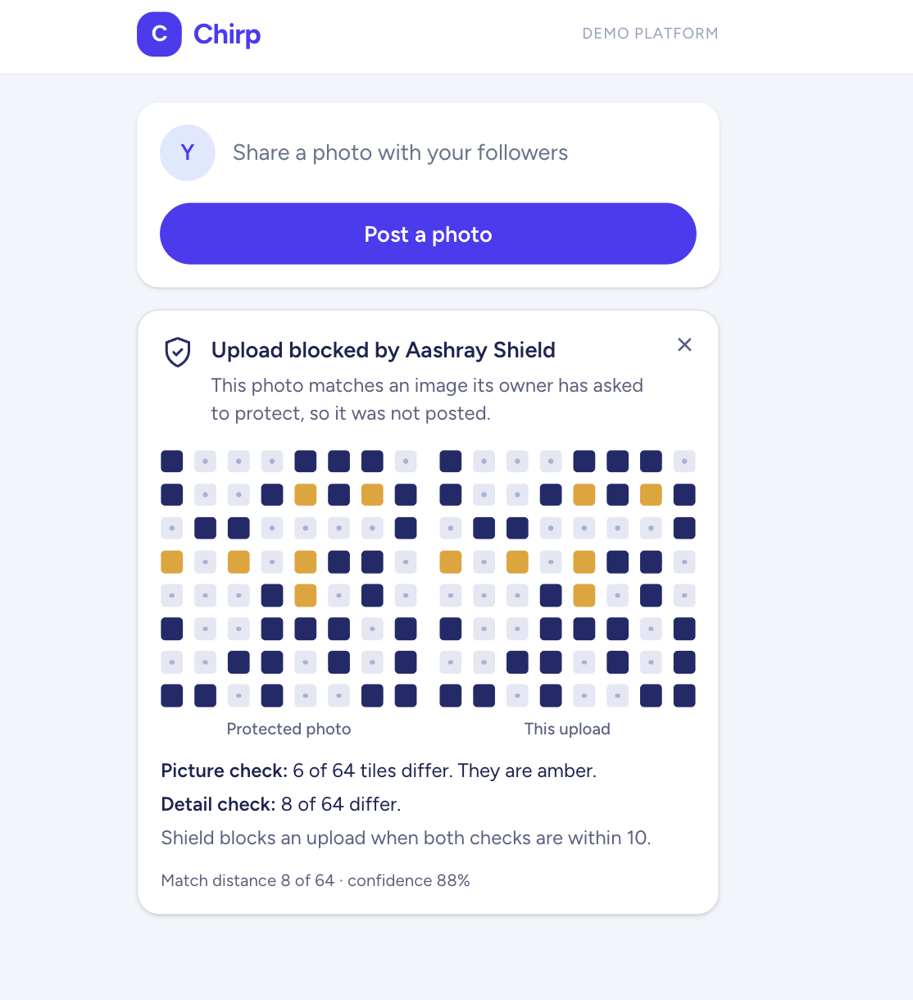
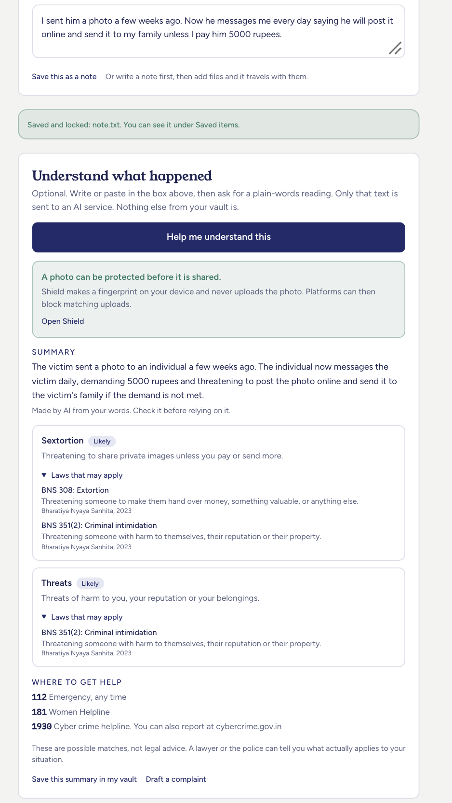
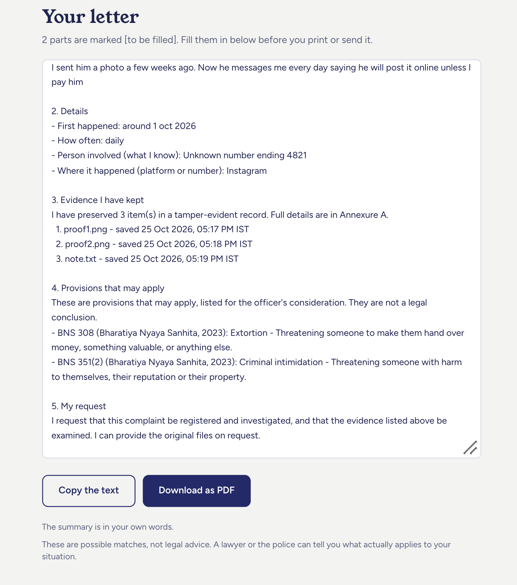
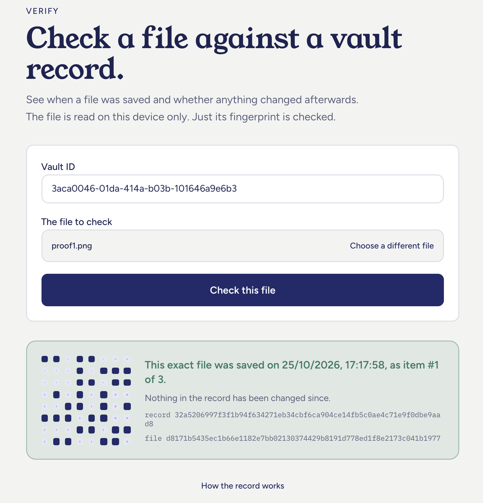

<div align="center">

# Aashray &nbsp;·&nbsp; आश्रय

### *Save now. Decide later.*

**A private place to keep what happened, and a shield that stops a photo from spreading.**

recHERsion'26 &nbsp;·&nbsp; Problem Statement 2: Women's Safety &nbsp;·&nbsp; NIT Karnataka

</div>

---

> It is late. She has a few screenshots, a voice note, and a message that has made her stomach drop.
> She is not ready to call the police. She is not sure it is "serious enough". She just does not want it to disappear, and she does not want anyone else to see it.
>
> Most tools ask her to decide something right now. **Aashray asks her for nothing.**
> It lets her save, quietly and safely, and decide later. Or never.

*Aashray* (आश्रय) means **shelter**. That is the whole idea.

---

## The problem

When someone is harassed, threatened or blackmailed online, two things go wrong, and they go wrong fast.

1. **The evidence is fragile.** Messages get deleted, accounts vanish, and screenshots are easy to dismiss as "edited". Even a victim who does everything right can be told she cannot prove it.
2. **The photo travels faster than help.** If an intimate or fake image is posted, it is copied within minutes. By the time a report is filed, there are dozens of copies.

On top of that, reporting feels like a cliff. People do not want to walk into a police station with a half-formed story. So they do nothing, and the evidence is lost.

## What Aashray does

Aashray has three parts. Each one is built on a single rule: **private by design**.

### 1. Vault: a locked place for what happened

Add screenshots, photos, recordings, files, or just your own words. Everything is **encrypted on your device with your passphrase before it is uploaded**. The server stores scrambled data it cannot read. Not even the people who built Aashray can open your vault.

Every item you save is also **sealed together with the one before it**, like links in a chain. Change any item later and every item after it stops matching. That makes the record something you can stand behind: it shows *when* each thing was saved and that *nothing has been altered since*.

### 2. Shield: stop a photo before it spreads

Pick a photo you are afraid might be shared. Your device turns it into a short **fingerprint of 64 tiles**. Only that fingerprint is sent. **The photo never leaves your device.**

A platform that joins checks every upload against those fingerprints. If a copy is uploaded, even a **mirrored or lightly edited** one, it is blocked before anyone sees it. The demo app (*Chirp*) shows this live, tile by tile, with the differences highlighted.

### 3. Tools for when she is ready

When, and only when, she decides to act:

| Tool | What it does |
|---|---|
| **Understand** | An optional AI reading of what she wrote, in plain words. It gives a calm summary, the likely type of abuse, the laws that may apply, and the help numbers. **Off until she asks. Only the text she typed is sent.** |
| **Complaint draft** | A police complaint drafted from her vault, with the possible BNS and IT Act provisions listed. It is made on her device and not stored. |
| **Court certificate worksheet** | Digital evidence needs a certificate under Section 63 of the Bharatiya Sakshya Adhiniyam. Aashray prepares the information worksheet, with the evidence hashes already filled in. |
| **Takedown notice** | A notice to have an intimate, morphed or impersonating image removed, with the platform's response deadline counted down. |
| **Verify** | Anyone with the vault ID can check a file against the record and see when it was saved and whether the chain is intact. |

---

## Designed to be gentle

The product is as much about how it *feels* as what it does.

- **No legal or police language on the first screens.** Nothing that makes a frightened person close the tab.
- **No red.** Nothing flashes alarm. Warnings are amber, safe is green.
- **Quick exit.** One tap, or pressing Esc twice, leaves the page at once.
- **No account, no name, no phone number, no email.** Only a passphrase that she chooses.
- **AI is off by default.** She chooses when, and what text, if any, to share.
- **Every promise is visible.** Shield shows "Photo bytes uploaded: 0", and the exact JSON that was sent is one click away.
- **Built for a phone.** Every page works at phone width.

---

## How it works



**The vault chain.** Each entry stores `entry_hash = SHA-256(file_hash | saved_at | previous_entry_hash)`. The first item chains to a fixed start value. The check recomputes the whole chain and reports the first item that no longer matches.

**Shield matching.** The device computes a perceptual hash (32x32 DCT) and a difference hash, for the photo and for its mirror image. A platform upload is blocked when **both** hashes are within a distance of 10 out of 64, so resizing, small edits and flips are caught while unrelated photos pass.

**The tiles.** A 16-character hash is exactly 64 bits, and 64 bits is exactly an 8x8 grid. Aashray draws every fingerprint as that grid, a small *jaali* (latticed screen), so the invisible becomes something you can see, compare and trust.

---

## What is stored, and what is not

| | Stored on the server | Never leaves her device |
|---|---|---|
| **Vault** | Encrypted files and notes, file hashes, timestamps, the chain | Passphrase, encryption key, file contents, file names |
| **Shield** | Fingerprints (64-bit hashes) | The photo itself |
| **Drafts** | Nothing | Everything |
| **Understand (AI)** | Nothing stored by Aashray. Only the text she typed is sent, and only when she clicks. | Her files and everything else in the vault |

---

## Screenshots

| Vault | Shield | Chirp blocks a copy |
|---|---|---|
|  |  |  |

| Understand | Complaint | Verify |
|---|---|---|
|  |  |  |

---

## Run it

**You need:** Python 3.12, Node.js 20 or newer, PostgreSQL 16, and Git.

> The full step-by-step guide, with every command for Windows and macOS, is in [`SETUP.md`](SETUP.md). The short version:

**1. Get the code**
```bash
git clone https://github.com/pixelprachi/aashray.git
cd aashray
```

**2. Backend** (terminal 1)

macOS:
```bash
cd backend
python3.12 -m venv venv
source venv/bin/activate
pip install -r requirements.txt
cp .env.example .env
```
Windows (PowerShell):
```powershell
cd backend
py -3.12 -m venv venv
venv\Scripts\Activate.ps1
pip install -r requirements.txt
Copy-Item .env.example .env
```
Open `.env` and set your PostgreSQL password in `DATABASE_URL`. Create an empty database named `aashray`. `GEMINI_API_KEY` is optional. Without it, everything works except the AI "Understand" panel. Then:
```bash
uvicorn app.main:app --reload
```
The API is now at http://localhost:8000, and its interactive docs are at http://localhost:8000/docs.

**3. Frontend** (terminal 2)
```bash
cd frontend
npm install
npm run dev
```
Open http://localhost:3000.

---

## Try it in two minutes

1. **Vault.** Open `/vault`, create a vault, add a screenshot and a short note. Watch the items link into a chain. Click **Check that nothing was changed** and watch each item turn green.
2. **Understand.** Write an *invented* message in the note box and click **Help me understand this**. Never use real messages while testing.
3. **Shield.** Open `/shield`, protect a photo, and note **Photo bytes uploaded: 0**. Click through to the demo platform, upload a *mirrored copy*, and watch it get blocked, with the differing tiles in amber. Upload an unrelated photo and watch it post.
4. **Act.** From the vault, draft a complaint (and download the PDF), prepare the Section 63 worksheet, and write a takedown notice.
5. **Verify.** Open `/verify` and check a file against the vault ID.

---

## API at a glance

| Area | Endpoints |
|---|---|
| Vault | `POST /vault` · `GET /vault/{id}` · `POST/GET /vault/{id}/evidence` · `GET /vault/{id}/evidence/{eid}/blob` · `GET /vault/{id}/verify` · `GET /vault/{id}/lookup/{sha256}` |
| Shield | `POST /shield/register` · `POST /shield/match` |
| AI | `POST /ai/classify` |
| Drafts (stateless) | `GET /draft/types` · `POST /draft/complaint` · `POST /draft/pdf` · `POST /draft/takedown` · `POST /draft/section63` |

Full request and response shapes are in the live docs at `/docs`.

---

## Built with

**Frontend:** Next.js 16 (App Router, TypeScript), Tailwind CSS 4, the Web Crypto API
**Backend:** FastAPI, SQLAlchemy 2, PostgreSQL 16, reportlab, httpx
**Crypto:** PBKDF2-SHA256 (600,000 rounds), AES-GCM 256, SHA-256, perceptual hashing (pHash and dHash)
**AI:** Google Gemini, optional and off by default

---

## Honest limits

We would rather you know exactly what this is.

- **It is a prototype, and not legal advice.** The laws shown are *possible* matches. A lawyer or the police decide what applies. The drafts are starting points, not filings.
- **Shield is not magic.** It catches copies that are resized, lightly edited or mirrored. A photo that is heavily cropped, shrunk or recompressed can slip past. It only protects photos registered with it, and only on platforms that choose to check.
- **There is no password reset, by design.** If the passphrase is lost, the vault cannot be opened by anyone. That is the price of nobody else being able to read it.
- **The court certificate** needs a person to sign it (Part A by the declarant, and Part B by an expert where the court requires). Aashray prepares the worksheet. It does not replace that person.
- **AI can be wrong.** The summary is made from her own words and is labelled so. She is told to check it, and her original note is always kept.
- **Free-tier AI note.** On Google's free Gemini tier, inputs may be used to improve Google's products. Use *invented* text only when testing, and use a paid key for any real deployment.

---

## If you or someone you know needs help right now

| | |
|---|---|
| **112** | Emergency, any time |
| **181** | Women Helpline |
| **1930** | Cyber crime helpline. You can also report at [cybercrime.gov.in](https://cybercrime.gov.in) |

---

## The team

Built for recHERsion'26 by **Rishi Jha** ([@rishi-jha-exe](https://github.com/rishi-jha-exe)) and **Prachi Sahu** ([@pixelprachi](https://github.com/pixelprachi)).

<div align="center">

*No one should have to be brave and organised on the worst day.*
**Aashray makes sure the evidence is, so she does not have to be.**

</div>
